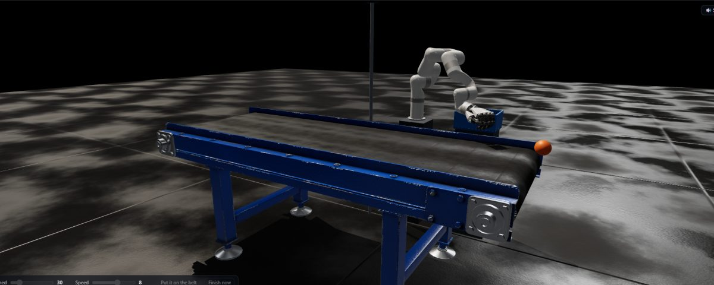

<!-- esasim: cover -->

<!-- /esasim: cover -->

<!-- Banner: upload a picture named banner.png under Data › Readme pictures (the cell from the Whole cell view works well), then:  -->

# Conveyor grasping with a five-fingered hand

**An xArm with a five-fingered hand learns to see the objects coming on a conveyor belt, pick them up with simulated contact forces and put them in a bin. Then you test it on objects it has never seen, in the pose you choose.**

The robot senses through a camera beside it and 19 touch sensors (each digit's tip, middle and first phalanx, and four zones of the palm). The xArm 6 and the hand are simulated bodies in MuJoCo: the arm's six joints are servo-driven through inverse kinematics, and every force between the fingers, the palm, the object, the belt and the bin is computed.

     

## Overview

Objects of 18 training shapes are dropped onto a belt running at 5 to 10 cm/s: upright, on their side or tumbled, at any orientation. Next to the belt are the xArm 6 with the hand, a camera on a pole and a bin.

1. **See**: a small convolutional network learns, from the camera's depth and colour, which pixels belong to the object and from them its box: where it is, how big, which way its long side lies.
2. **Place** (the main stage): the policy first learns from a scripted pick-and-place controller that uses only what the robot senses (its hand, its touch sensors and the camera's box): it imitates it, then drives itself while the controller corrects it (DAgger). Then PPO fine-tunes it on the real reward (object in the bin), with a fading term that keeps it close to the demonstrations and a capped step size.
3. **Test**: one cell in real time, on 12 shapes it never trained on (a banana, a stepped cone, a drill, a pear, a duck and others), driven by the learned policy or by the scripted controller.

**Reach** and **Grasp** are also available as stages of their own (grasp learns from the same demonstrations); they are not needed before Place.

All models are built by the project itself from simple shapes (boxes, cylinders, spheres, capsules, ellipsoids). Better-looking models can replace them later without changing the learning.

## Flows

| Flow | What it does |
|---|---|
| [**1 · Learn to see**](https://esacode.com/app/projects/25/flows/84) | Trains the camera network (about 25 minutes on an RTX 3070). |
| [**4 · Learn to place**](https://esacode.com/app/projects/25/flows/88) | Learns from demonstrations, then PPO: the stage that does the whole task. 1024 cells, 45 to 100 minutes. |
| [**5 · Test with new objects**](https://esacode.com/app/projects/25/flows/89) | One cell, in real time, driven from the View. |
| [2 · Learn to reach](https://esacode.com/app/projects/25/flows/85) · [3 · Learn to grasp](https://esacode.com/app/projects/25/flows/87) | Optional stages on their own. |

Every flow has the **Conveyor grasping (xArm + 5-finger hand)** block in the matching mode, reading and writing its networks in the **grasp-networks** dataset.

## The View

- **The cell** in 3D: the belt, the bin, the camera on its pole, the object, the hand with every finger joint, and the xArm.
- **What the camera sees**: the camera's picture, drawn three times finer than the network's own 96×72 for whoever watches (the network keeps its own). Over it:
  - in **yellow**, the object's box as the camera network sees it, and in **orange** its long axis;
  - in **cyan**, the hand's grasping axis, from the thumb's tip to the middle of the index and middle fingertips. In a good grasp the cyan line crosses the orange one;
  - the hand's **pressure sensors** as dots, grey when they feel nothing, yellow to red up to 10 N. They are drawn only when the palm side of the hand faces the camera, so the palm is never taken for the back of the hand.
- **Touch**: the force on each digit and palm zone, in newtons, and the hand's pressure map.
- During training, episodes of the learning cells are replayed with their result (their camera pictures carry the same lines).
- **Test with a new object**: choose the object, how it lies, how it is turned and the belt speed (5 to 10 cm/s, the range it trained on), then press **Put it on the belt**. The object is dropped 25 cm in from the start of the belt; the hand waits at rest until the object reaches the stretch where training objects start, then picks it.

## The grasp

The hand grasps across the object, not along it: the line along which the thumb closes against the fingers lies across the object's long axis, and the palm stays level. Measured on the hand alone and then in the whole cell:

- The hand is turned 40° beyond square to the object's long axis (the thumb-to-fingers line is not the hand's own x axis), and the grasp point sits towards the thumb's side, further for wide objects (a disc lying flat: 42% → 92% held on the hand alone).
- The grasp (the hand's turn, height and offset) is chosen from the camera's clear view, before the hand comes down. As the fingers come round the object they hide part of it and the camera network takes them for part of it (its top seen up to 2 cm too high, its axis turned). So while the fingers are down round it, the cell keeps the object's height, size and axis as last seen clearly and only goes on following where it is (touched, an object slows down on the belt). The policy sees the same.
- The hand follows the object where the camera sees it, without leading it. It goes down once over it, closes even when the belt or the object stops it short of the grasp height, and gives up a descent the arm cannot complete and plans it again from above (before this, one object in eight passed by while the hand was stuck mid-descent).
- It feels the object: if its touch sensors say the hand holds nothing while it lifts or carries, it opens and tries again, instead of carrying an empty hand to the bin.

## What is computed

| Part | How |
|---|---|
| **Physics** | MuJoCo 3 (CPU) or MuJoCo Warp (GPU): 2 ms steps, 40 ms control steps; elliptic friction cones |
| **Arm** | xArm 6 with UFACTORY's kinematics; position servos with the motors' torques, gravity compensated; the policy says where the hand should be (x, y, z, yaw, pitch, roll) and inverse kinematics sets the joints. The hand sits on an adapter 11.8 cm from the flange |
| **Hand** | 5 fingers, 15 joints, position servos with limited torque. The policy sets each finger's curl and the thumb's swing under the palm |
| **Touch** | 19 MuJoCo touch sensors, all of them given to the policy |
| **Camera** | 96×72 depth, colour and segmentation, 6 frames a second (the picture shown in the View is drawn again at 288×216) |
| **Camera network** | encoder-decoder CNN on each pixel's 3D point (from the depth) and its shaded colour: an object mask, then the box (centre, half sizes, yaw). The policy gets the box, not the picture |
| **Scripted controller** | over the object, down, close the hand, lift slowly at first, carry round the arm's base, open over the bin; the grasp as above |
| **Policy** | behaviour cloning + DAgger from the controller, then PPO with an asymmetric critic (the policy sees only what the robot could sense; the critic also sees the true object state). Network 512-256-128 |
| **Rewards** | place: distance gained towards the bin with the object in hand, released over the bin, resting in it; dropping it or knocking it off costs |

## Where it runs

- **NVIDIA GPU** (needed for learning in reasonable time): MuJoCo Warp. On an 8 GB card (RTX 3070) **1024 cells learn faster than 2048**: with objects in the hands the contact physics is heavy, and 2048 cells run about three times slower in total.
- **CPU**: MuJoCo, one simulation per thread. Fine for the test and for checks; slow for learning.
- **Run on: NVIDIA GPU** sends the block only to workers with an NVIDIA GPU.
- A worker whose PyTorch is built for the CPU only gets a CUDA build of it once, in its data folder, for this block only. If the worker's Windows service account cannot see the GPU (nvidia-smi says it lacks permission), runs there use the CPU: give that account access to the GPU.

## What you need

- A worker with an NVIDIA GPU and its driver. The packages `torch`, `mujoco`, `mujoco-warp`, `warp-lang` and `numpy` are installed by the worker.
- No account or key.

## How to run it

1. Run **1 · Learn to see** (once; again only if the cell changes).
2. Run **4 · Learn to place**. With **Training: Start over** it learns from demonstrations first; with **Continue** it carries on from the newest place policy of this cell (if that one succeeds less than half the time, it learns from demonstrations again first).
3. Run **5 · Test with new objects**, switch to **View**, choose an object and its pose, and press **Put it on the belt**. Left alone, it picks the new objects itself, one after the other.

## Settings worth knowing

On the **Conveyor grasping** block: **What to do** (the mode), **Run on**, **Cells learning at once** (1024 on an 8 GB GPU), **Minutes**, **Training** (Continue or Start over), **Live cell while learning** (No by default: a real-time cell in the same process slows learning several times; the view then replays episodes of the learning cells), and for the test: **Test: who drives** (the learned policy, or the scripted controller it learns from), **pace**, **pick objects when idle**, **Test objects** (new only or all).

## Which policy is used

Policies are carried on from (and tested) only if they were learned in the same version of the cell (each policy records a fingerprint of the cell; a policy without one is from an older cell). Among those, the furthest stage is used, then the newest. Each run keeps the best snapshot it reached and never overwrites it with a worse one, so the newest policy of a stage is that run's best.

## What you get

- `grasp_see_<date>.pt`: the camera network.
- `grasp_<stage>_<date>_<success>.pt`: the policies, each saved together with the camera network it used.
- `see.csv`, `reach.csv`, `grasp.csv`, `place.csv`: the learning curves. `test.csv`: one row per test trial (object, pose, yaw, belt speed, grasped, in the bin, largest touch force).

## How well it does now

- **The scripted controller**: about 89% of training objects in the bin when they come from upstream as in the test (898 episodes), and 15 of 17 of the new test objects (88%). When the hand gets one clean attempt, 97% end in the bin. The weakest are objects lying flat (flat box, disc) and the rod.
- **The learned policy** imitates the controller closely on the controller's own data but, driving alone, succeeds only 34–39% of the time, and PPO has not improved on that. The controller keeps memory of where it is in the task (its phase, how long it has been going down, the grasp it chose from above); the policy sees only the present moment. Giving it that memory (a recurrent network, or the task's phase as an input) is the next step. Until then, test with **Test: who drives: The scripted controller**.
- After the belt lane moved, the cell's fingerprint changed: policies learned before do not apply to it.

## Data and licences

The xArm's kinematics and meshes come from [xarm_ros](https://github.com/xArm-Developer/xarm_ros) by UFACTORY (BSD 3-Clause). The cell, the hand and the objects are made by the project. MuJoCo and MuJoCo Warp are Apache 2.0; PyTorch is BSD.

## Notes

- Success during learning is counted with the policy's exploration noise, over the episodes that have ended; early in a run the short episodes end first, so the first figures run low or high before they settle.
- EsaSim keeps 20 000 live items per run, so the block spreads the 3D view's episodes over the run's minutes: during learning an episode is shown every couple of minutes, and none while the demonstrations are being collected.
- A cell whose physics blows up (rare, among thousands) is restarted, and the log counts how often.

<!-- esasim: files of the project -->

---

An [EsaSim](https://esacode.com/) project of the workspace Gianluca De Novi's workspace (Robotics & manipulation).

### Blueprints in this repository

- [1 · Learn to see](blueprints/1-learn-to-see.json) · 9 blocks · version 9
- [2 · Learn to reach](blueprints/2-learn-to-reach.json) · 11 blocks · version 7
- [3 · Learn to grasp](blueprints/3-learn-to-grasp.json) · 11 blocks · version 7
- [4 · Learn to place](blueprints/4-learn-to-place.json) · 11 blocks · version 11
- [5 · Test with new objects](blueprints/5-test-with-new-objects.json) · 10 blocks · version 15
- [Learn on all my machines (a round)](blueprints/learn-on-all-my-machines-a-round.json) · 14 blocks
- [Maintenance · Rebuild the 3D models (after the hand, objects or conveyor change)](blueprints/maintenance-rebuild-the-3d-models-after-the-hand-objects-or-.json) · 3 blocks · version 15

### Workspace blocks it uses

- [Conveyor grasping (xArm + 5-finger hand)](blocks/ws-conveyor-grasping-xarm-5-finger-hand) · version 101
- [Camera picture](blocks/ws-camera-picture) · version 1
- [Hand pressure map](blocks/ws-hand-pressure-map) · version 2

### Assets

The files the project's views draw with (3D models, textures, sounds), in [assets/](assets/):

- [covers/37d82793-5abc-4476-91d0-99524aba329e.png](assets/covers/37d82793-5abc-4476-91d0-99524aba329e.png) · 921 KB
- [grasp-policy/grasp_grasp_20261119_0649_86.pt](assets/grasp-policy/grasp_grasp_20261119_0649_86.pt) · 4.9 MB
- [grasp-policy/grasp_grasp_20261120_0000_87.pt](assets/grasp-policy/grasp_grasp_20261120_0000_87.pt) · 5.1 MB
- [grasp-policy/grasp_place_20261119_0849_67.pt](assets/grasp-policy/grasp_place_20261119_0849_67.pt) · 4.9 MB
- [grasp-policy/grasp_reach_20261119_0516_17.pt](assets/grasp-policy/grasp_reach_20261119_0516_17.pt) · 4.9 MB
- [grasp-policy/grasp_reach_20261119_1633_90.pt](assets/grasp-policy/grasp_reach_20261119_1633_90.pt) · 4.9 MB
- [grasp-policy/grasp_reach_20261119_2227_00.pt](assets/grasp-policy/grasp_reach_20261119_2227_00.pt) · 5.1 MB
- [grasp-policy/grasp_see_20261119_0340.pt](assets/grasp-policy/grasp_see_20261119_0340.pt) · 1.4 MB
- [grasp-policy/grasp_see_20261119_0352.pt](assets/grasp-policy/grasp_see_20261119_0352.pt) · 1.4 MB
- [grasp-policy/grasp_see_20261119_1531.pt](assets/grasp-policy/grasp_see_20261119_1531.pt) · 1.4 MB
- [grasp-policy/grasp_see_20261119_2103.pt](assets/grasp-policy/grasp_see_20261119_2103.pt) · 1.4 MB
- [grasp-policy/grasp_see_20261119_2126.pt](assets/grasp-policy/grasp_see_20261119_2126.pt) · 1.4 MB
- [grasp-policy/grasp_see_20261121_1813.pt](assets/grasp-policy/grasp_see_20261121_1813.pt) · 1.4 MB
- [models/belt_objects.robot.json.gz](assets/models/belt_objects.robot.json.gz) · 482 KB
- [models/simple_rubber_conveyor.glb](assets/models/simple_rubber_conveyor.glb) · 2.9 MB
- [models/xarm6_left_hand_rigged.glb](assets/models/xarm6_left_hand_rigged.glb) · 16 MB
- [models/xarm_hand.robot.json.gz](assets/models/xarm_hand.robot.json.gz) · 238 KB
- [textures/esacode-logo.png](assets/textures/esacode-logo.png) · 25 KB
- [textures/preview (56).webp](assets/textures/preview%20(56).webp) · 46 KB

The data the blueprints read (grasp-networks) stays in EsaSim.

Keys pasted in blocks (secret settings) are not saved here, nor are the team and the results of runs.
